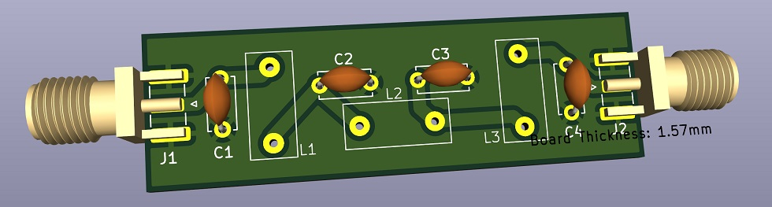
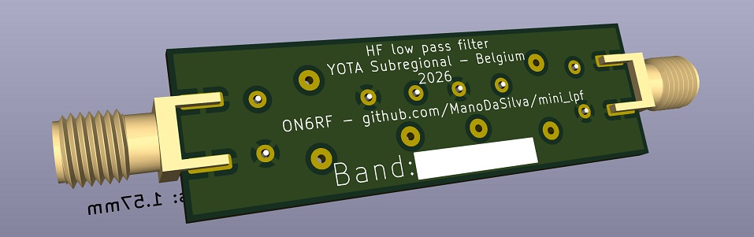

# Mini LPF: an HF low pass filter kit

A small low pass filter (LPF) for QRP transmitters on the HF amateur bands, from 80m to 10m. It has SMA connectors on both ends and three hand-wound toroidal inductors.

This is an entry-level project. The aim is to learn how a low pass filter works and how to design and wind a toroidal inductor. You choose your band, wind three coils and solder four capacitors. The result is a working harmonic filter you can put after any small transmitter, such as an Si5351 beacon or a QRP PA.




## Context

The kit was designed for a YOTA (Youngsters On The Air) sub-regional event, with 30 kits to build in a workshop. YOTA is the youth programme of IARU Region 1 ([ham-yota.com](https://www.ham-yota.com/), [IARU R1 Youth](https://www.iaru-r1.org/about-us/committees-and-working-groups/youth/)).

The design goals for the event were:

- Low cost: under 2 EUR per participant if possible.
- Few different parts: one core type and one wire size for every band.
- SMA input and output, on a custom PCB.
- A choice of band for each participant: 80m, 40m, 20m, 15m or 10m.

The design is not limited to the event. Anyone who needs a small harmonic filter or wants to learn about filters can use it. The table below covers all HF bands from 80m to 10m.

## Repository content

| Folder | Content |
|---|---|
| `mini_lpf_pcb/` | KiCad project: schematic, PCB and footprints |
| `docs/` | Source documentation, including the original G-QRP filter article (`gqrplpf.pdf`) |

## Working principle

A transmitter does not only put out its wanted frequency. It also puts out harmonics: signals at 2, 3, 4 or more times that frequency. A square-wave source, such as an Si5351 or a switching PA, is rich in odd harmonics. These harmonics can cause interference on other bands, and radio rules require them to be kept low.

A low pass filter lets frequencies below its cutoff pass with little loss and attenuates frequencies above it. This filter is a 7-element Chebyshev design by Ed Wetherhold, W3NQN. George Dobbs, G3RJV, published a practical version for the G-QRP Club (see `docs/gqrplpf.pdf`). It uses standard capacitor values, which makes it easy to build.

```
IN o----+---L1---+---L2---+---L3---+----o OUT
        |        |        |        |
        C1       C2       C3       C4
        |        |        |        |
       GND      GND      GND      GND
```

The filter has 50 ohm input and output impedance and is symmetrical, so IN and OUT can be swapped.

Component numbering in this repo follows the signal path: C1, L1, C2, L2, C3, L3, C4. The G-QRP article numbers the parts 1 to 7 along the ladder. The mapping is:

| This repo | G-QRP article |
|---|---|
| C1, C4 | C1, C7 |
| C2, C3 | C3, C5 |
| L1, L3 | L2, L6 |
| L2 | L4 |

## Band values (80m to 10m)

All coils are wound on a T37-6 (yellow) core. Capacitor values are in pF. Inductance values come from Table 1 of the G-QRP article, except 60m, which comes from the QRP Labs LPF kit (the G-QRP article has no 60m filter).

| Band | Cutoff F-co (MHz) | -3 dB (MHz) | C1, C4 (pF) | C2, C3 (pF) | L1, L3 (µH) | L1, L3 turns | L2 (µH) | L2 turns |
|---|---|---|---|---|---|---|---|---|
| 80m | 4.125 | 5.11 | 470 | 1200 | 2.434 | 28 | 3.012 | 32 |
| 60m | | | 680 | 1200 | 2.12 | 27 | 2.30 | 28 |
| 40m | 7.36 | 9.04 | 270 | 680 | 1.380 | 21 | 1.698 | 24 |
| 30m | 10.37 | 11.62 | 270 | 560 | 1.090 | 19 | 1.257 | 20 |
| 20m | 14.40 | 16.41 | 180 | 390 | 0.773 | 16 | 0.904 | 17 |
| 17m | 18.93 | 22.89 | 110 | 270 | 0.548 | 13 | 0.668 | 15 |
| 15m | 21.55 | 27.62 | 82 | 220 | 0.444 | 12 | 0.561 | 14 |
| 12m | 25.24 | 28.94 | 100 | 220 | 0.438 | 12 | 0.515 | 13 |
| 10m | 31.66 | 40.52 | 56 | 150 | 0.303 | 10 | 0.382 | 11 |

Notes on the table:

- The G-QRP article winds 80m on a T37-2 (red) core with 25 and 27 turns. This repo uses T37-6 on every band so that the kit needs only one core type. On T37-6, 80m needs 28 and 32 turns.
- For 40m, Table 4 of the G-QRP article lists 19 and 21 turns on T37-6. The turns formula with the Table 1 inductances gives 21 and 24 turns. The QRP Labs kit also uses 21 and 24 turns on T37-6 for 40m. This repo uses 21 and 24.
- For 17m, the G-QRP value for C1 and C4 is 110 pF. QRP Labs uses 100 pF because 110 pF is hard to find. 100 pF and 10 pF in parallel give 110 pF.
- For 80m and 60m, 1200 pF can be made from 1000 pF and 220 pF in parallel (1220 pF), or 680 pF and 470 pF (1150 pF).

## Designing a coil yourself

The number of turns comes from the inductance and the core's AL value:

```
N = 10 x sqrt(L / L10)
```

- N is the number of turns.
- L is the inductance you need, in µH.
- L10 is the inductance of the core with 10 turns, in µH. For a T37-6 it is 0.30 µH. For a T37-2 it is 0.40 µH.

Example for the 20m L1: N = 10 x sqrt(0.773 / 0.30) = 16.05, so 16 turns.

Round to the nearest whole number of turns. The AL value of the core has a tolerance of about 5%, so the result does not need to be more precise than that.

The same formula works with the AL value given in nH per turn squared: N = sqrt(L / AL). For a T37-6, AL is 3.0 nH/turn².

## Recommended components

| Qty | Part | Notes |
|---|---|---|
| 3 | T37-6 iron powder toroid (yellow) | Micrometals or Amidon. Unbranded cores may use a different mix. Measure a sample before you buy many. |
| 1.5 m | Enamelled copper wire, 0.35 to 0.4 mm (AWG 27 to 26) | Use solderable (polyurethane) enamel, which strips with a hot soldering iron. |
| 4 to 8 | Ceramic disc capacitors, C0G / NP0 | Values from the table. 5.08 mm lead spacing. 50 V or more, 100 V if you use more than 5 W. |
| 2 | SMA female, edge-mount | Made for a 1.6 mm board. Check the footprint against the exact part you buy. |
| 1 | PCB from `mini_lpf_pcb/` | 2 layers, 1.6 mm FR4 |

Why T37-6: Micrometals mix 6 is made for about 3 to 40 MHz, which covers all bands from 80m to 10m. The G-QRP article (Table 3) rates the T37-6 for up to 25 W.

Why 0.4 mm wire: the hardest coil is the 80m L2 with 32 turns. With enamel, 0.4 mm wire is about 0.45 mm thick. 32 turns take about 14.4 mm of the 15 mm available at the inner edge of the core. It fits in one layer, but only just. 0.35 mm wire leaves more room. On the higher bands the wire size does not matter, because the coils have far fewer turns.

### About capacitors

C0G (also sold as NP0) capacitors are the right choice. Their value stays stable with temperature and voltage, and their RF loss is low.

Generic ceramic discs without a temperature rating can work, with some care:

- Avoid Z5U and Y5V types. Their value can drop by half when cold, which moves the cutoff up so far that the 2nd harmonic is barely attenuated.
- Y5P and X7R types are acceptable. They add about 0.5 dB of loss, which does not matter at QRP power.
- Buy each value from one batch. When all capacitors are off in the same direction, the filter stays matched. When some are high and some are low, the match gets poor (return loss of 5 to 8 dB).
- Small values (100 pF and below) are usually class 1 ceramics anyway, even when sold as generic.
- If you can, measure a few capacitors of each batch with a component tester.

## Winding the toroids

- Each time the wire passes through the centre of the core counts as one turn. Count the turns on the inside of the core.
- Cut the wire first. A coil needs about 1.3 cm of wire per turn on a T37, plus about 7 cm for the leads and a margin. Example: 32 turns x 1.3 cm + 7 cm = 49 cm.
- For long coils, start in the middle of the wire. Thread the core onto the wire so the first turn sits at the middle. Wind half the turns with one end, then turn the core over and wind the rest with the other end, going on in the same direction around the core. You only pull half the wire through each time. This trick comes from the QRP Labs instructions.
- Pull each turn tight against the core. Loose turns change the inductance and move around later.
- Spread the turns evenly over about three quarters of the core. Leave a gap between the start and the end of the winding. If the two ends are too close, they add capacitance.
- For the 80m coils, wind the turns touching each other on the inner edge from the start. Otherwise the last turns will not fit in one layer. If a few turns end up on top of the others, the coil still works.
- To fine-tune: pushing the turns closer together raises the inductance a little, and spreading them lowers it.
- Strip and tin the leads. Solderable enamel melts at about 380 to 400 °C. Hold the lead in a blob of solder on the iron until it is shiny and tinned. With other enamel, scrape it off with a blade or fine sandpaper. A lead that is not tinned all round makes a bad joint, which is the most common fault in this kit.
- Tin the leads up to about 2 mm from the core, so no bare enamel sits in the solder joint.
- On the PCB the core stands upright. A dot of hot glue or nail varnish under the core keeps it from moving.

If you have an LC meter or a NanoVNA, measure each coil before you solder it in.

## Building

1. Solder the two SMA connectors first. They are the largest parts and the board must sit flat between their legs.
2. Solder the four capacitors. Keep their leads short and the body close to the board.
3. Wind and solder L1, L2 and L3. Check the turn count for your band twice before soldering.
4. Write your callsign and band in the box on the board.

## Testing

With a NanoVNA, or another vector network analyser:

1. Calibrate with the cables you will use, including a through connection.
2. Connect the filter between port 1 and port 2.
3. Sweep from 1 MHz to about 4 times your band.
4. Check the insertion loss (S21) in your band. Expect less than 0.5 dB with C0G capacitors.
5. Check the return loss (S11) in your band. 15 dB or better is good.
6. Check the attenuation at 2 and 3 times your band frequency.

Typical simulated values with C0G capacitors and the turn counts in the table: about 0.2 dB loss in band, about 20 dB return loss or better, and about 55 dB attenuation at the 3rd harmonic on 80m and 10m.

Without a VNA, you can check the SWR of the filter into a 50 ohm dummy load with your transmitter. A good filter shows a low SWR on its band. A coil with the wrong number of turns usually shows up as a high SWR.

## Using the filter

Put the filter between the transmitter output and the antenna. If you use an amplifier, the filter goes after the amplifier. A filter before a switching PA does not help, because the PA creates harmonics again.

An Si5351 alone gives about 10 mW into 50 ohms. With this filter, that is enough for a WSPR beacon. K6HX reports spots at more than 900 km on 20m with about 10 mW and a G3RJV filter on T37-6 cores ([K6HX blog](https://brainwagon.org/blog/post-field-day-report-on-k6hx-beacon-operations/)).

The filter is designed for QRP power, up to 10 W as in the G-QRP article.

Transmitting on the amateur bands requires a licence. For tests and demonstrations without a licensed operator, transmit into a 50 ohm dummy load.

## Sources

- George Dobbs, G3RJV, "A Short Guide to Harmonic Filters for QRP Transmitter Output", G-QRP Club Technical Page 2, 2009. Based on the W3NQN articles in Short Wave Magazine, December 1983 and January 1984. Archived page: [web.archive.org](https://web.archive.org/web/20100124053352/http://www.gqrp.com/technical2.htm). Copy in this repo: `docs/gqrplpf.pdf`.
- QRP Labs, Low Pass Filter kit: [kit page](https://www.qrp-labs.com/lpfkit), [assembly instructions](https://www.qrp-labs.com/images/lpfkit/instructions2a.pdf), [60m values](https://www.qrp-labs.com/images/lpfkit/instructions2.pdf), [toroid evaluation](https://www.qrp-labs.com/images/lpfkit/toroid.pdf).
- Micrometals RF toroid data (dimensions and AL values): [table](https://cx1ddr.myqnapcloud.com/toroide/mtoroids.htm).
- Electronic Design, "Designing Extended-Range Toroidal Inductors" (T37-6 between 3 and 40 MHz): [article](https://www.electronicdesign.com/technologies/components/article/21773038/designing-extended-range-toroidal-inductors).
- SOTABEAMS, low pass filter designs (loss with inductor Q of 140): [PDF](https://www.sotabeams.co.uk/content/LPF-DESIGNS.pdf).
- Mark VandeWettering, K6HX, beacon report: [blog](https://brainwagon.org/blog/post-field-day-report-on-k6hx-beacon-operations/).
- YOTA: [ham-yota.com](https://www.ham-yota.com/).

## Licence

This project is free hardware and documentation: you can redistribute it and/or modify it under the terms of the GNU General Public License as published by the Free Software Foundation, version 3 of the License, or (at your option) any later version. See [LICENSE](LICENSE).

This project is distributed in the hope that it will be useful, but WITHOUT ANY WARRANTY; without even the implied warranty of MERCHANTABILITY or FITNESS FOR A PARTICULAR PURPOSE. See the GNU General Public License for more details.

Exception: `docs/gqrplpf.pdf` is © 2009 GQRP Club. It is included as a reference and is not covered by the GPL.
